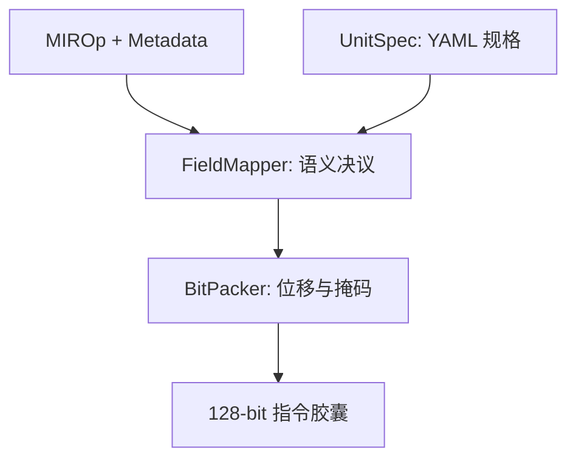

# 驱动层架构详细设计 (Driver Micro-Architecture SDD) [ADM-M19]

## 1. 系统概述 (System Characterization)

驱动层 (Driver Layer) 是 AIACC 编译器的“物理具象化”阶段。其核心使命是将逻辑上的算子描述 (`MIROp`) 根据硬件规格文件 (`UnitSpec`) 机械地转换为物理比特流 (`128-bit Capsules`)。

自 ADR-006 起，驱动层采用 **“无偏见打包 (Unbiased Packing)”** 原则：驱动程序不再拥有关于算子的业务逻辑（如“加法如何转减法”），而是完全由输入 `metadata` 和 `UnitSpec` 共同驱动。

## 2. 软件子系统架构 (Subsystem Architecture)



### 2.1 模块映射： FieldMapper (语义决议)
`FieldMapper` 的职责是将语义标识符转换为比特数值。其决议流程遵循以下 **“优先级瀑布 (Waterfall Priority)”**：

1. **显式控制位 (Highest)**：如果 `op.metadata` 中存在与 `UnitSpec.code_fields` 同名的 Key（如 `SUB`），则无条件采用该数值。
2. **抽象语义映射 (Med)**：处理 `rbank`, `raddr` 等通用存储访问标识符。
3. **Spec 默认值 (Low)**：若以上均不存在，采用 `UnitSpec` 中定义的 `default` 初始值。

### 2.2 模块映射： BitPacker (物理打包)
`BitPacker` 负责最终的位移、掩码和零填充逻辑。它通过以下计算公式确保 100% 的物理对齐：

```python
# 位移公式
bits = sum((field_val & mask) << field_offset)
# Header 注入
capsule = bits | (HEADER_VLD << VLD_OFFSET)
```

## 3. 重要数据结构协议 (Interface Contracts)

### 3.1 增强型 MIROp 元数据协议
算子库向驱动层传递的 `metadata` 必须包含以下标准化字段：
* **`SUB`**: (0:ADD, 1:SUB) - 仅针对 FPADD 等双模单元。
* **`SRC_PREC` / `DST_PREC`**: (0:16bit, 1:32bit) - 用于自适应位宽映射。
* **`p_src_id`**: (RtoVR 物理端子 ID) - 用于 RtoVR 路由映射。

### 3.2 驱动-仿真器闭环协议 (Rounding Parity)
驱动生成的二进制指令流必须同时满足：
- **物理宽度验证**：不得超过 NPU 物理总线宽度 (通常为 128-bit)。
- **解码幂等性**：`Decode(Encode(Op)) == Op`（比特级别语义无损）。

## 4. 异常处理准则 (Error Handling)

- **物理溢出 (Physical Overflow)**：如果某个元数据数值超过了 YAML 定义的比特位宽（如字段宽 3，却传入了 9），驱动层必须立即抛出 `RuntimeError`。
- **孤立属性 (Isolated Attributes)**：如果算子提供的 metadata 无法匹配到任何 YAML 字段，驱动层将在 `DEBUG` 模式下记录“属性孤立警告”，但在 `PROD` 模式下应静默过滤以保持兼容性。
