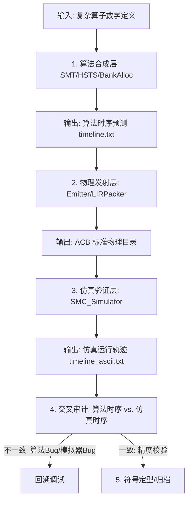

# AIACC V5.0 算子开发与验证标准化协议 (ADPC)

本协议定义了 70+ 算子从数学公式到 Bit-Perfect 验证的工业化全生命周期。核心思想是：**“由算法预测时序，由仿真验证时序，通过交叉审计剥离 Bug。”**

## 1. 标准开发流程架构 (Standardized Architecture)

---

## 2. 阶段性交付清单 (Deliverables)

### 2.1 算法合成阶段 (Synthesis)
- **输入**: 算子的 DFG (原子算子精度声明)。
- **核心逻辑**: SMT Synthesizer 自动计算最优 Pipeline 深度与 IQ 分配。
- **产物**: **`timeline.txt`**。此文件标记了每个指令在 Global T 轴上的启动拍位。

### 2.2 物理发射阶段 (Emission)
- **指令转换**: `LIRPacker` 将语义 OpType 映射为物理 Bit-Field。
- **产物**: ACB 目录包（含 `sim_config.json`, `iq_n.hex`）。确保其物理 Bank 分配已处理冲突规避。

### 2.3 物理仿真阶段 (Simulation)
- **执行过程**: `SMC_Simulator` 严格按照 Hex 指令内容回放周期。
- **产物**: **`timeline_ascii.txt`**。通过 `TraceRecorder` 自动抑制闲置行，实现高密渲染。

---

## 3. 核心调试机制：交叉审计 (The Cross-Audit)

这是 SOP 中最关键的质量控制点。当 `PASSED` 为假时，必须执行以下审计：

| 审计项 | 比对对象 | 判等逻辑 | 结论指向 |
| :--- | :--- | :--- | :--- |
| **时序审计** | `timeline.txt` vs `timeline_ascii.txt` | 逐 Cycle 检查指令点火对齐 | 若不齐，则 SMT 调度模型或硬件 Spec 建模有误 |
| **数值审计** | Python Golden vs SMC Output | 容差 $5 \times 10^{-3}$ 内判等 | 若不齐，则 `FieldMapper` 物理比特编码或数学系数有误 |

---

## 4. Bank 冲突鲁棒性验证：并发群覆盖 (CCUG-Matrix)

为确保 AIACC 编译器在任何物理 Bank 布局下均能产出正确的指令流，我们引入 **“并发访问团 (Concurrent Access Cliques, CAC)”** 鲁棒性验证机制。

### 4.1 核心理论：空间并发与端口瓶颈
*   **并发条件**：多路读取指令在同一 $T$ 周期（Cycle）点火。
*   **冲突定义**：当并发读取请求总数 $K$ 中，有任何两个或多个请求指向同一个物理 Bank ID 时，硬件必须执行串行化或 Stall。
*   **验证目的**：证明 SMT 调度算法能在任意 $2^K$ 种 Bank 分配位图中，通过动态插入“物理气泡（Bubble）”化解冲突，同时保持数学结果 Bit-Perfect。

### 4.2 验证实施步骤 (The CCUG Sweep)

1.  **团探测 (Clique Extraction)**：
    运行初始合成任务，根据预测的 `algo_timeline.txt`，扫描出所有在同一拍启动访存的节点集 $G = \{n_1, n_2, \dots, n_k\}$。
2.  **矩阵生成 (Matrix Generation)**：
    针对该并发团，生成基于二元占据状态（Bank 0 vs Bank 1）的 $2^K$ 种配置。
3.  **注入与审计 (Injection & Audit)**：
    *   **全隔离态**：预期 $T$ 指标最短，性能最优。
    *   **全冲突态 (All-on-One)**：预期 SMT 会在 $T$ 轴中产生显著拉伸，强制串行化执行。
    *   **交叉点位**：通过 `timing_diff_audit.txt` 检查每一处“气泡”的插入是否符合硬件时延规格。

### 4.3 为什么只测 $2^K$？
由于硬件是并行的，冲突的本质是 **“端口占用位的重合”**。对于一个 4 输入的计算单元，其内部冲突的所有拓扑结构（全碰撞、部分碰撞、无碰撞）均能被 $2^4=16$ 种位图完全覆盖，无需穷举所有物理 Bank 编号。

---

*Generated by AIACC Architect. v5.1.0-robustness.*
