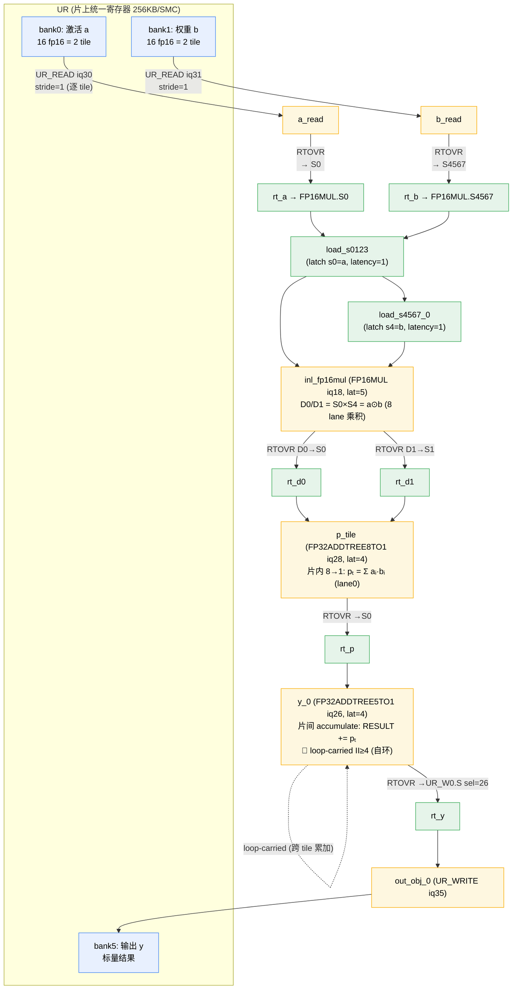
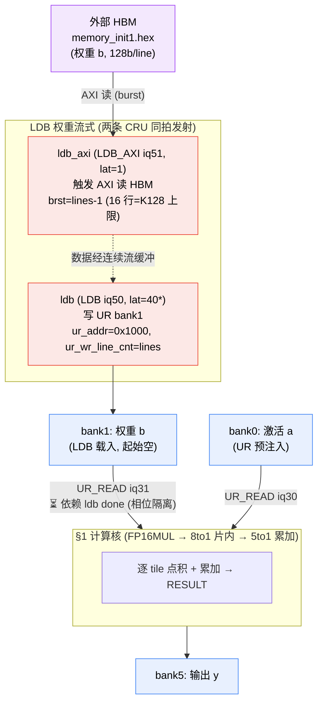

# AIACC Matmul 数据流动图

> 目的：把**当前测试通过**的 matmul 示例的数据流动画成图，供理解与分析。
> 生成日期 2026-07-03。数据来自各算子 `get_dfg()`（`verification_v2/ops/matmul_op.py`）+ `hw_config/pipeline_delays.yaml`。

---

## 0. 当前通过的 matmul 示例一览

| 算子（`--op`） | K（收缩维） | 列数 | SMC | 权重来源 | e2e（Python sim） | VCS bit-match（硅证） |
|---|---|---|---|---|---|---|
| `fp16_matmul_min` | 8（1 tile） | 1 | 1 | UR 预注入 bank1 | ✅ | —（最小通路） |
| `fp16_matmul_k16` | 16（2 tile） | 1 | 1 | UR 预注入 | ✅ | ✅ 155.144（ADR-049） |
| `fp16_matmul_k24` | 24（3 tile） | 1 | 1 | UR 预注入 | ✅ | ✅ |
| `fp16_matmul_k32` | 32（4 tile） | 1 | 1 | UR 预注入 | ✅ | ✅ |
| `fp16_matmul_k2048` | 2048（256 tile=满 bank） | 1 | 1 | UR 预注入 | ✅ | ✅ |
| **`fp16_matmul_k16_ldb`** | 16 | 1 | 1 | **HBM→LDB→bank1** | ⚠️ 仅 VCS | ✅ 155.144（ADR-050 阶段1） |
| **`fp16_matmul_k128_ldb`** | 128（16 tile） | 1 | 1 | **HBM→LDB→bank1** | ⚠️ 仅 VCS | ✅ 1246.825（单条多行 burst，brst=15） |
| `fp16_matmul_k32_stream_ldb` | 32 | 1 | 1 | HBM→LDB→bank1 | ⚠️ 仅 VCS | ✅ 268.035 |
| `fp16_matmul_q` | 8 | 4（稠密 32 乘） | 1 | UR 预注入 | ✅ | —（ADR-032 S2） |
| `matmul_parallel_n` | — | — | 8（N 维广播） | UR 预注入 | ✅ | ✅ 8/8（ADR-025） |
| `fp16_matmul_n` | 8 | 4 | 8（N 维广播） | UR 预注入 | ✅ | ✅ 8/8（ADR-023） |

> ⚠️ **`*_ldb` 系列在 Python sim（e2e）里报 `FAILED y`** —— sim **不建模** HBM→LDB 载入（bank1 起始空），
> 故只能靠 **VCS**（真 RTL）验证；e2e 的 max-diff 恰等于 golden 值（如 K16=155.144），即 sim 输出 0。
> 本文以 **`fp16_matmul_k16`**（核心累加）与 **`fp16_matmul_k16_ldb`**（+权重流式）为主线画图，其余是其参数化/并行化扩展。

---

## 1. 核心数据流：`fp16_matmul_k16`（单-SMC 单列点积累加核）

**任务**：`y = dot(a, b)`，`a`/`b` 各 16 个 fp16（= 2 个 K=8 tile）。
**钦定 reduce 结构（hco 据 spec 表517/520/§1193）= 两级归约**（因 `FP32ADDTREE8TO1` **无 accumulate 位**，不能在 8to1 里跨-tile 累加）：
- **片内**（每 tile）：`FP16MUL`（8 乘）→ `FP32ADDTREE8TO1`（8→1）→ 部分和 `p_t = Σ aᵢ·bᵢ`
- **片间**（跨 tile）：`p_t` → `FP32ADDTREE5TO1`（**accumulate=1**）→ 累加器 `RESULT += p_t`

循环 `K//8 = 2` 个 tile（`inner_loops=1` → 2 迭代），累加自环在 5to1（latency=4 → **II≥4**）。

### 1.1 数据流动图（DFG）



### 1.2 ASCII 流水线（含单元/IQ/延迟标注）

```
  bank0 (激活 a)              bank1 (权重 b)
      │ UR_READ iq30              │ UR_READ iq31       ← 每迭代读 1 tile(8 fp16)，stride=1 逐 tile 推进
      ▼ (lat 1)                   ▼ (lat 1)
   [a_read]                    [b_read]
      │ RTOVR→S0 (lat 1)          │ RTOVR→S4567 (lat 1)
      ▼                           ▼
   ┌──────────────────────────────────────────┐
   │  FP16MUL  (iq18, lat 5)                    │   load_s0123/s4567 微指令先 latch s_bank
   │  D0/D1 = S0 × S4 = a⊙b  (8 lane 乘积)      │   (ADR-047 D1: 缺则 s_bank=0→乘积恒0)
   └──────────────────────────────────────────┘
      │ RTOVR D0→S0, D1→S1 (lat 1)
      ▼
   ┌──────────────────────────────────────────┐
   │  FP32ADDTREE8TO1 (iq28, lat 4)  【片内】    │   dst_id=0 锁死 → 结果恒落 lane0
   │  pₜ = Σᵢ aᵢ·bᵢ   (8→1 平衡树)              │   (8to1 无 accumulate 位，不能跨-tile 累加)
   └──────────────────────────────────────────┘
      │ RTOVR→S0 (lat 1)
      ▼
   ┌──────────────────────────────────────────┐
   │  FP32ADDTREE5TO1 (iq26, lat 4) 【片间】     │   accumulate=1 (5to1 有累加位)
   │  RESULT += pₜ    🔁 loop-carried II≥4      │   自环: 迭代 t 累加到迭代 t-1 的 RESULT
   └──────────────────────────────────────────┘
      │ RTOVR→UR_W0.S sel=26 (lat 1)
      ▼
   [out_obj_0] ── UR_WRITE iq35 (lat 1) ──▶ bank5 (y = Σₜ pₜ = dot(a,b))
```

### 1.3 逐 tile 数值展开（K16 = 2 tile）

```
tile 0:  p₀ = a[0:8]·b[0:8]  = Σ aᵢbᵢ  (i=0..7)     ← FP16MUL→ADDTREE8TO1
         RESULT = 0 + p₀                              ← ADDTREE5TO1 accumulate (初值 0)
tile 1:  p₁ = a[8:16]·b[8:16] = Σ aᵢbᵢ (i=8..15)
         RESULT = p₀ + p₁                             ← 累加环 (loop-carried)
────────────────────────────────────────────────
  y = RESULT = p₀ + p₁ = dot(a,b) = 155.14395  (K16 golden, VCS bit-match)
```

---

## 2. 权重流式变体：`fp16_matmul_k16_ldb` / `k128_ldb`（ADR-050）

与 §1 **完全相同的计算核**，唯一区别：**权重 `b` 不预注入 UR，而是运行时从外部 HBM 经 LDB 载入 bank1**。
这验证真实 LLM 场景——权重矩阵（8–33MB）≫ UR（256KB），必须 HBM/LDB 流式载入。

### 2.1 数据流动图（权重流式前端 + §1 计算核）



### 2.2 关键契约（VCS 取证，ADR-050）

- **两条 CRU（`ldb_axi` 读侧 + `ldb` 写侧）必须同拍发射**（均无 dep → SMT 同排 t=0）。写侧 FSM latch 描述符、等 AXI 取回数据后写 UR；错拍 → 写 FSM 不 latch → bank1=0。
- **`line_byte_cnt` 是总字节数**（非每行）：设 `16×lines`，否则 beat1 的 write-enable 塌成 0x0001。
- **相位隔离**：`b_read` 依赖 `ldb`，边权 = LDB 保守上界 **latency 40**（LDB 是变延迟 DMA=AXI HBM 往返+写 UR，非固定流水；DEBT-050-VARLAT）。使 `b_read` 排在 LDB 全部写完之后再读 bank1。
- **单条 LDB 上限 = brst 4-bit ≤15 = 16 beats = 16 行 = K128**（AXI burst 位宽，非字段限）。
- **K>128**：多-chunk（多描述符）—— **当前 blocked on RTL**（写侧连续流缓冲 residue re-baseline defect + done-握手 EN_COND=0，见 [ADR-050](adr/ADR-050-ldb-load-to-ur-weight-streaming.md) DEBT-050-KGT128）。

### 2.3 K128 = 单条 LDB 载 16 tile（多-tile 大 K）

```
HBM 16 line 权重 ──LDB(brst=15,单条)──▶ bank1[0..15]  ──▶ §1 计算核循环 16 tile 累加
                                                            RESULT = Σ_{t=0..15} pₜ = 1246.8252 (VCS bit-match)
```

---

## 3. 图例（Bank / IQ / Unit / RTOVR）

### 3.1 Bank 布局（单-SMC 单列）
| Bank | 内容 | 说明 |
|---|---|---|
| bank0 | 激活 `a` | UR_READ iq30 |
| bank1 | 权重 `b` | UR_READ iq31（LDB 变体经 HBM 载入） |
| bank5 | 输出 `y` | UR_WRITE iq35 |

UR = 8 bank × 256 行 × 16 byte = **32KB/SMC**（2048 fp16/bank），全片 8 SMC = 256KB。

### 3.2 计算单元 + 延迟（`hw_config/pipeline_delays.yaml`）
| 单元 | IQ | latency | 角色 |
|---|---|---|---|
| UR_READ | 30/31 | 1 | 读激活/权重 |
| FP16MUL | 18 | 5（load 微指令 latch=1） | 8 lane fp16 乘：D=S0×S4 |
| FP32ADDTREE8TO1 | 28 | 4 | **片内** 8→1 归约（无累加位） |
| FP32ADDTREE5TO1 | 26 | 4 | **片间** accumulate（有累加位，累加环 II≥4） |
| UR_WRITE | 35 | 1 | 写结果 |
| RTOVR | — | 1 | RtoVR 交叉开关：搬运单元输出↔输入选择端口（S0/S4567/D0/D1/…） |
| LDB_AXI | 51 | 1 | 触发 AXI 读 HBM（ordering） |
| LDB | 50 | 40* | 写 UR bank1（*保守上界，变延迟 DMA） |

### 3.3 RTOVR 的作用
`RTOVR`（RtoVR）不是计算，是**数据路由**——把一个单元的输出寄存器搬到下一个单元的输入选择端口（如 `rt_a` 把 `a_read` 结果送到 `FP16MUL.S0`）。DFG 里每个计算单元前后的 `rt_*` 节点都是路由，latency=1。

---

## 4. 其他变体（并行化扩展，简述）

- **`fp16_matmul_q`（4 列稠密，K=8）**：1 条 FP16MUL 算满 32 乘（4 权重列 S0-S3 × 广播激活 S4-S7）→ 8 个 D → **4 条 FP32ADDTREE8TO1**（dst_id 0/1/2/3）→ bank5 一词 4 lane `[Q0,Q1,Q2,Q3]`。即 §1 的 FP16MUL→8to1 段横向复制 4 份。
- **`fp16_matmul_n` / `matmul_parallel_n`（8-SMC N 维广播）**：激活经 **SHIFTUP 广播**到 8 个 SMC，每 SMC 与**本地权重列**点积（reduce 在 SMC 内 §1 计算核），每 SMC partitioned 输出。跨-SMC **只有广播、无 sum-reduce**（ADR-025）。即 §1 计算核 × 8 份并行 + 广播前端。

```
          激活 a ──SHIFTUP 广播──┬──▶ SMC0: a·w₀ → y₀
                                 ├──▶ SMC1: a·w₁ → y₁
                                 │        ⋮  (每 SMC = §1 计算核)
                                 └──▶ SMC7: a·w₇ → y₇
                          (跨-SMC 无求和，各自 partitioned 输出)
```

---

## 5. 数值验证链（端到端）

```
SymPy/numpy golden ──┐
                     ├─▶ 比对 ◀── Python sim (model-A, 终值 parity)   ← e2e --mode e2e
prepare_input(rng0) ─┘                    │
                                          └─▶ VCS (真 RTL, bit-match)  ← --mode hw-parity / 手动 VCS
                                                bank5 解码 = 整16字节反转 4×LE fp32 对 golden
```

- **e2e（Python sim）**：验终值 parity（不验跨-tile/跨-SMC 时序），`*_ldb` 除外（sim 不建模 HBM→LDB）。
- **VCS（真 RTL）**：bit-match 硅证。`k16/k24/k32/k2048` + `k16_ldb/k128_ldb/k32_stream_ldb` + `matmul_parallel_n/fp16_matmul_n` 均已 VCS bit-match。

---

## 附：相关文档
- 累加核载 latency 修复：[ADR-049](adr/ADR-049-fp16mul-load-microinstruction-latch-latency.md)
- 权重流式（LDB）：[ADR-050](adr/ADR-050-ldb-load-to-ur-weight-streaming.md)
- 8-SMC N 维广播：[ADR-025](adr/ADR-025-matmul-parallel-n-broadcast-addtree.md)
- FP16 matmul 4 列稠密 / 8to1：[ADR-032](adr/ADR-032-fp16-matmul-fp16mul-addtree8to1.md)
- 术语：[glossary.md](glossary.md)（SMC/UR/Bank/IQ/RtoVR/LDB/II）
