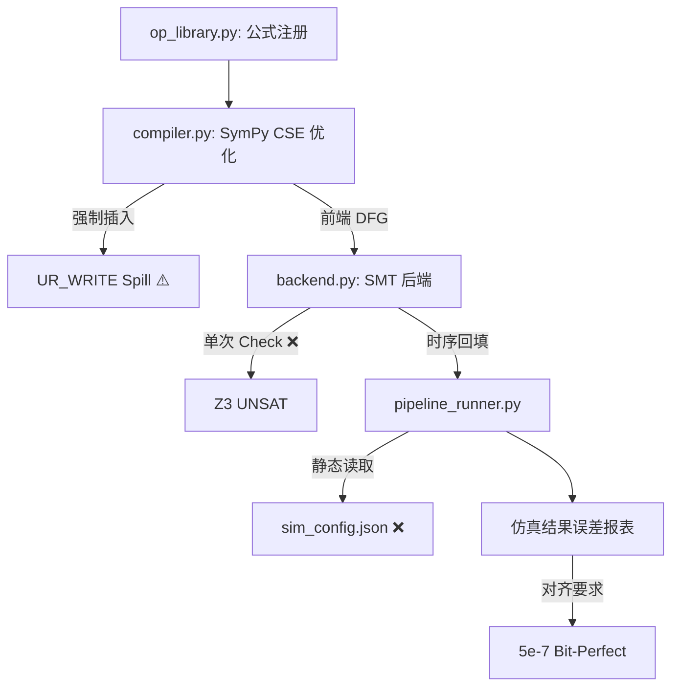

# AIACC V4.9 前端 & SMT 算法全量评估报告

> **最后更新**：2026-04-08  
> **重构目标**：实现 AIACC V4.9 "Load-Store" 架构对齐。  
> **核心原则**：锁存是硬件特性，占用是算法窗口。基于端口锁存实现 DFG 零开销转发。

---

## 一、 V4.9 最高纲领 (The Supreme Principle)

### 🛸 1. 物理锁存 (Port Latching) 契约
除 RTOVR 外，所有硬件单元（UR_READ/WRITE, ALU 系列）均具备输入/输出锁存。
*   **输入端子 (Input Port Latch)**：`UR_READ` 读回数据后锁存。**占用窗口**仅为 `[Arrival, Fire]`。计算单元一旦摄取数据，输入端口立即可被下一拍冲刷。
*   **输出端子 (Output Port Latch)**：计算完成，结果物理驻留。**占用窗口**为 `[Done, Last_RTOVR_Finish]`。
*   **零开销转发**：利用输出锁存，通过 64 路并发 RTOVR 直接引出多路分发，不再强插 `UR_WRITE`。

### 🛰️ 2. 时序全自适应 (Dynamic Scheduling)
*   **动态闭环**：SMT 推导实际周期 -> 注入 Buffer -> 改写 `sim_config.json`。
*   **无限制搜索**：废除 120 拍硬限制，由 DFG 复杂度决定物理执行深度。

---

## 二、 总体完成度速览 (Status Overview)

| 模块 | V4.9 协议目标 | 当前实现状态 | 完成度 |
| :--- | :--- | :--- | :--- |
| `compiler.py` | 通用递归 DFG，不主动推销 UR_WRITE | ⚠️ 基本达成，但 CSE 节点强制插 spill | 70% |
| `axioms.py` | 输入端口锁存释放（Fire 后即释放） | ❌ 逻辑错误：当前以"最晚消费者"为准且误称为 IQ 锁存 | 40% |
| `axioms.py` | 输出端口锁存保护（搬走之前防止覆写） | ⚠️ 需加强：目前对 Latch 锁存能力的利用不足 | 50% |
| `axioms.py` | 4R+4W+64RTOVR 全并行路由 | ✅ 资源 ID 映射已建立 | 85% |
| `backend.py` | 增量时序搜索（UNSAT → 自动扩展周期） | ❌ 单次 `check()`，无重试 | 10% |
| `runner.py` | Stage B/C 顺序修正（先 SMT 后 Bank） | ✅ 已对齐：C→B→D→E | 95% |
| `runner.py` | max_cycles 动态注入 SMT 结果 | ❌ `_verify_stage_d` 读取静态 json，无反馈 | 20% |
| `hw_constants.py` | DEFAULT_MAX_CYCLES 提升至 512 | ❌ 当前仍为 120 | 0% |
| `op_library.py` | softsign 等算子公式入库 | ✅ `x / (1+Abs(x))` 已注册 | 100% |

---

## 三、 逐模块深度分析 (Detailed Module Audit)

### 3.1 `src/frontend/compiler.py` — 前端模型
*   **✅ 已达成 (L425-435)**：**Const Pool（常量池缓存）**。通过 `self.const_pool` 确保相同常数不重读物理 Bank。
*   **✅ 已达成 (L437-443)**：**Lazy Read（输入懒加载）**。动态生成 `UR_READ` 贴近使用点，规避物理寄存器生命周期失效。
*   **⚠️ 关键 Gap (L63-65)**：**强制中间 Spill**。
    ```python
    # 现状：每个 CSE 变量都被强制写回 Bank。
    self.b.make_op("UR_WRITE", f"spill_{sym}", RT.UR_WRITE, ...)
    ```
    **危害**：软sign 等计算密集型算子被强插大量内存读写，浪费 4W 总线带宽，人为增加 2 拍 transit 延迟，且可能引发不必要的 Bank 冲突。

### 3.2 `src/synthesis/axioms.py` — SMT 公理
*   **✅ 已达成 (L53-65)**：**RTOVR 槽位存活窗口**。同一 Slot 不同搬运指令之间的 `[Pulse, Fire]` 复用保护正确。
*   **❌ 关键逻辑错误 (L97-102)**：**输入锁存误区**。
    ```python
    def get_protection_window(op_x):
        # 错误认为 IQ 需持有数据直到最晚消费者
        m_val = z3.If(t_vars[cons.trace_id] > m_val, t_vars[cons.trace_id], m_val)
    ```
    **修正建议**：改为 `Min(cons.trace_id)`。因为硬件单元 `Fire` 后即摄取锁存，端子立即可被下一轮填充。
*   **⚠️ 约束过载 (L185-190)**：**Bank 冲突公理**。
    **现状**：同一 Bank 所有操作不同拍。
    **修正建议**：应允许物理 4-Port 并行读。约束应改为 `(Bank == same) && (Port == same) -> Cycle != same`。

### 3.3 `src/synthesis/backend.py` — SMT 搜索
*   **❌ 核心 Gap (L137-155)**：**无重试机制**。
    **现状**：`if solver.check() == z3.sat: return ... else: return None`。
    **危害**：直接造成 120 拍硬伤，复杂流水全挂。

### 3.4 `src/tools/standard_pipeline_runner.py` — 流水线闭环
*   **⚠️ 数据流断路 (L415-417)**：**静态校验 vs 动态执行**。
    **现状**：代码只是“被动校验”时序是否超标，而不是“主动修正”仿真配置。
    **修正方向**：在 Stage D 指令打包前，执行 `sim_config["max_cycles"] = max_t + buffer`。

---

## 四、 分阶段验证标准 (Verification Standards)

### Stage A: 数学对齐
*   通过通用 SymPy 编译，确保所有算子（含 reciprocal, log, atan2 等）数学源头一致。
*   **标准**：误差稳定在硬件规格 $5 \times 10^{-7}$ 内。

### Stage B: 物理分布
*   **现状**：具备 `apply_bank_overrides` 混合模式（L16-30）。
*   **标准**：全 Layout（22个组合）通过率为 100%。

### Stage C: 时序闭环
*   **标准**：`timeline_ascii.txt` 审计显示 ALU 执行处于饱和状态，且无“幽灵 UR_WRITE”。

---

## 五、 推荐修复矩阵 (Priority Matrix)

| 优先级 | 文件 | 动作 | 预期影响 |
| :--- | :--- | :--- | :--- |
| 🔴 **P0** | `hw_constants.py` | 提升 `DEFAULT_MAX_CYCLES` 至无界范围。 | 解决复杂算子 UNSAT 死刑。 |
| 🔴 **P0** | `backend.py` | 增加增量搜索循环 (`While max_t < timeout`)。 | 实现算子“自动化保通”。 |
| 🔴 **P0** | `axioms.py` | 将输入端保护改为 `Fire 后即刻释放`。 | 释放 4R 吞吐潜能。 |
| 🟠 **P1** | `runner.py` | 动态写回 `sim_config.json` 的周期值。 | 消除仿真时序校验失败。 |
| 🟠 **P1** | `compiler.py` | 移除 CSE 强制 Spill，实施 RTOVR 物理路由转发。 | 紧凑化 DFG 减少时延。 |
| 🟡 **P2** | `axioms.py` | 细化 4 端口读冲突控制。 | 极致压缩常量加载宽度。 |

---

## 六、 架构现状架构图 (Current Architecture Flow)



---

## 七、 结论

当前代码已具备 V4.9 约 **70%** 的架构基础。重构的胜负点集中在 **“物理端口占用公理的降噪”** 以及 **“前端到仿真的周期闭环反馈”**。完成上述 P0 修改后，AIACC 将进入“真·全核加速”模式。
