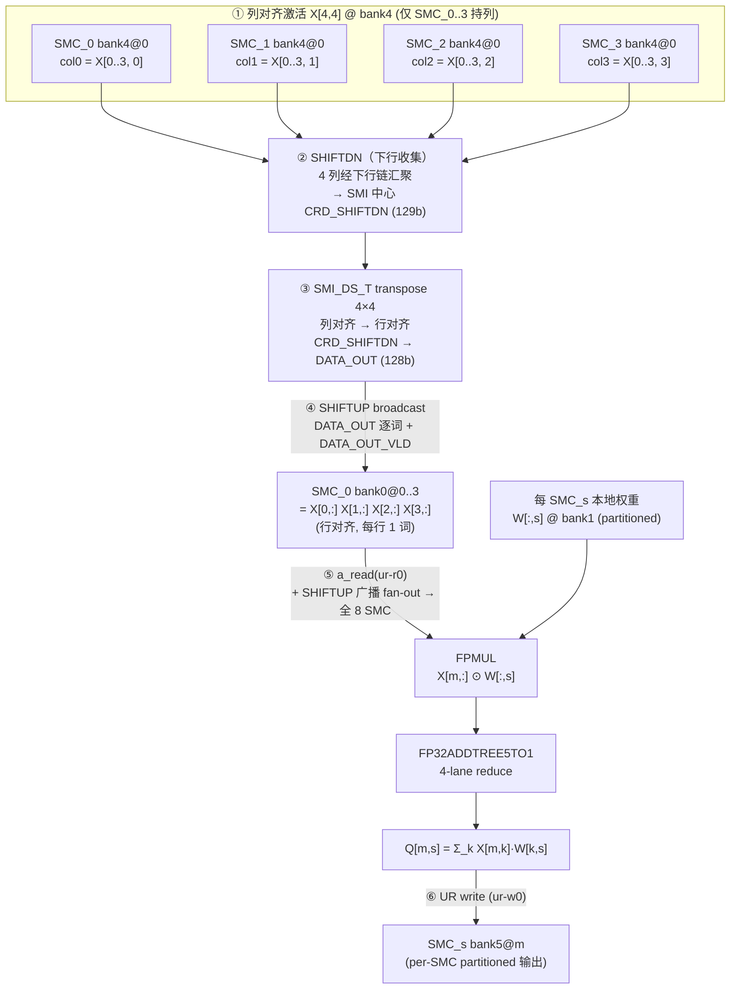
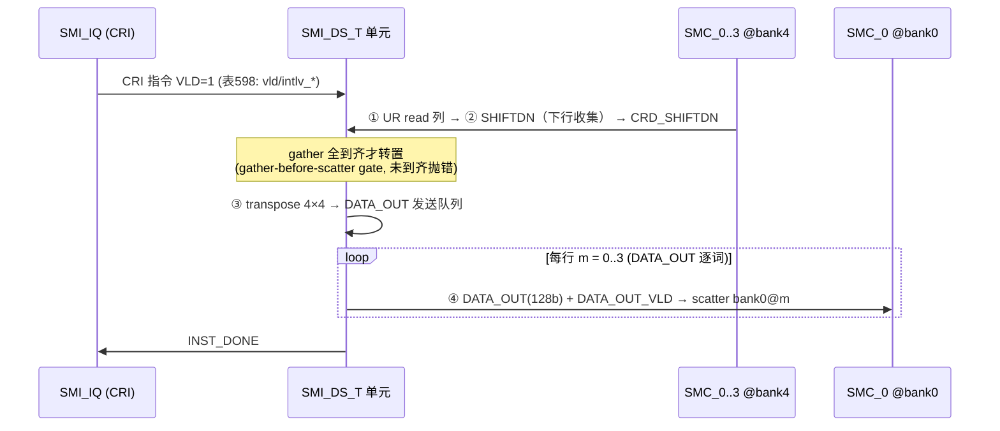

# matmul_q_dst 数据流向 + 时序（VCS 对齐参考）

> **用途**：VCS 测试 `matmul_q_dst` 时对齐数据流与依赖序。
> **来源**：实际编译产物 `build/verification_v2/matmul_q_dst/`（`compiler_schedule.json` II=1 + `sim_config.json` 的 `smi_ds_t` cfg）。
> **算子**：FP32, M=4 行, K=4 收缩维, 8-SMC。SMI_DS_T 跨-SMC 转置 datapath（ADR-033/034）。
> **精度对照**：`matmul_q_dst_k8`（FP32 K=8，转置行=2 词）/ `fp16_matmul_q_dst`（FP16 K=8，转置行=1 词，FP16MUL，ADR-035）。

---

## 1. 关键参数

| 项 | 值 | 说明 |
|---|---|---|
| M / K | 4 / 4 | 4 激活行 × 4 收缩维（FP32 → 1 行 = 1 个 128b 词） |
| SMI_DS_T cfg | `gather_smc_cnt=4, lanes=4, src_bank=4, dst_bank=0, element_bits=32` | gather 4 SMC × 4 lane → 转置 → 写 SMC_0 bank0 |
| bank 布局 | a=bank0(广播/转置落点) · b=bank1(权重,partitioned) · y=bank5(输出,partitioned) · **SRC_BANK=4**(列对齐激活源) | |
| II / max_cycles | 1 / 71 | |

---

## 2. 空间数据流（5 段 datapath，文档 para970：UR read — SHIFTDN — SMI_DS_T — SHIFTUP — UR write）



> ⚠ 当前实现：①②③④ 由 **SMI_DS_T 指令（`iq_smi-ds-t-0.hex`，表598 微指令）VLD 触发**；model-A 把 gather 直读各 SMC `bank4`（SHIFTDN 链逐拍物理 drain 未建，见 §5）。
>
> **S2-D1b：gather/scatter 的 UR 端点已打进 sim log（可与 VCS diff）**——`grep "Tag:DST-SHIFTDN\|Tag:DST-SHIFTUP"`：
> ```
> SMC_ID:0 Cyc:3 Unit:UR-READ  Tag:DST-SHIFTDN  Port:0 Bank:4 Addr:0 V0:<col0>   ① bank4 读 (×SMC_0..3)
> SMC_ID:0 Cyc:3 Unit:UR-WRITE Tag:DST-SHIFTUP Port:0 Bank:0 Addr:0 V0:<X[0,:]> ④ bank0 写 (×row 0..3, Cyc3..6)
> SMC_ID:0 Cyc:4 Unit:UR-READ  Tag:READ        Port:0 Bank:0 Addr:0 V0:<X[0,:]> ⑤ a_read 读 (晚 1 拍, 读到 ④ 写的值)
> ```
> 归属按 hco 订正：bank4 读 = **SMC_s 的 UR-read**、bank0 写 = **SMC_0 的 UR-write**（**非** SMI_DS_T；表596 SMI_DS_T 无 UR 端口）。

---

## 3. SMI_DS_T 转置细节（4×4，`out[lane][smc] = tile[smc][lane]`）

输入 Tile（列对齐，来自 4 SMC × 4 lane）→ 转置 → 输出（行对齐，写 SMC_0 bank0）：

| 输入 \ lane→ | 0 | 1 | 2 | 3 | | 输出 word | 内容 = X[m,:] |
|---|---|---|---|---|---|---|---|
| **SMC_0** (col0) | X0,0 | X1,0 | X2,0 | X3,0 | → | bank0@0 | X0,0 X0,1 X0,2 X0,3 = **X[0,:]** |
| **SMC_1** (col1) | X0,1 | X1,1 | X2,1 | X3,1 | → | bank0@1 | X1,0 X1,1 X1,2 X1,3 = **X[1,:]** |
| **SMC_2** (col2) | X0,2 | X1,2 | X2,2 | X3,2 | → | bank0@2 | X2,0 X2,1 X2,2 X2,3 = **X[2,:]** |
| **SMC_3** (col3) | X0,3 | X1,3 | X2,3 | X3,3 | → | bank0@3 | X3,0 X3,1 X3,2 X3,3 = **X[3,:]** |

FP32：一行 4 元素 = 1 个 128b 词。对照 K8 fp32 = 2 词 / fp16 = 1 词。



---

## 4. 时序：SMT 逻辑调度（II=1，row 0 单行链）

依赖序（**VCS 必满足**）：`ds_gather(0) < ds_transpose(1) < a_read(2) < shiftup(3)` —— gather → transpose → scatter(广播) → compute-read 严格有序。

```mermaid
gantt
    title matmul_q_dst SMT 逻辑调度 (II=1, row 0；横轴 = 逻辑拍 t)
    dateFormat X
    axisFormat %s
    section 转置前端
    ds_gather SHIFTDN (t0)        :a1, 0, 1
    ds_transpose SMI_DS_T (t1)    :a2, 1, 1
    section 读 + 广播
    a_read ur-r0 (t2)            :b1, 2, 1
    b_read ur-r1 (t3)            :b2, 3, 1
    shiftup_a_read (t3)          :b3, 3, 1
    section compute
    rt_a rt_b rtovr (t4)         :c1, 4, 1
    inl_mul FPMUL (t5, lat4)     :c2, 5, 4
    rt_mul rtovr-24 (t9)         :c3, 9, 1
    y_0 ADDTREE5TO1 (t10, lat4)  :c4, 10, 4
    rt_y_0 rtovr-35 (t14)        :c5, 14, 1
    out_obj_0 ur-w0 (t15)        :c6, 15, 1
```



- **单元延迟**（从调度 gap 读出）：FPMUL ≈ 4 拍（t5→t9）、FP32ADDTREE5TO1 = 4 拍（t10→t14）、UR_READ→RTOVR latch ≈ 2 拍。
- **M=4 行流水**（II=1）：row i 整体平移 +i 拍（row0 起 t=2，row3 起 t=5），末行输出 ≈ t=18；`max_cycles=71` 含排空。

---

## 5. ⚠ VCS 对齐：契约 vs model-A 近似（**不要逐拍对齐 model-A 列**）

| 维度 | 当前 sim (model-A) | VCS / RTL 真相 | 对齐建议 |
|---|---|---|---|
| **gather**（bank4 读） | log 有 `UR-READ DST-SHIFTDN`（SMC_s，S2-D1b）；SHIFTDN 链搬运**未建模** | SMC_s UR-read + SHIFTDN 链**逐拍 drain** 到 CRD_SHIFTDN | ✅diff 端点值/SMC_ID；❌SHIFTDN 事件数/时序 |
| **transpose 触发** | SMI_DS_T 指令 VLD（cluster cycle ≈ 3）；TRANSPOSE 仅 logger marker | CRI + 4 并发 interleave（**每两指令 2 拍 stagger**, para961） | 对齐「转置在 gather 全到齐后、a_read 前」 |
| **scatter**（bank0 写） | log 有 `UR-WRITE DST-SHIFTUP`（SMC_0，S2-D1b）；DATA_OUT 逐词 1 拍/词 | SHIFTUP + SMC_0 UR-write 端口 | ✅diff 端点值/addr；❌SHIFTUP 事件数/绝对拍 |
| **逐拍脆弱性** | scatter(1词/拍) 与 a_read(1行/拍) **同速率 0-容差** → bank0 同拍 R+W | COND 同步（无同拍 R+W） | 改 emit/read 速率会破；**diff harness 须豁免 DST-* 的 bank0 同拍 R+W，勿误判 ADR-008** |
| **smc_id_en** | sim 全盲（8/8 是 sim-vs-golden 自洽） | 真 8-SMC 各分支 | **VCS 必验 SMC_1..7 各算对** |
| **转置粒度** | element 粒度 | **byte 粒度**（para1037） | K=4 fp32 每元素 4 byte 不跨词 → 等价 |

**一句话**：和 VCS 对齐 **§2/§3 的空间数据流 + §4 的依赖序（gather<transpose<scatter<read）+ 转置终值**；**不要**逐拍对齐 SMI_DS_T 内部的 gather-drain / interleave-stagger / scatter 绝对拍——那些 sim 是 model-A 占位，RTL 才是真相。

---

## 6. 固件文件（VCS 加载，`build/verification_v2/matmul_q_dst/`）

- 全局指令流（8-SMC lockstep 共享）：`iq_ur-r0.hex`(a_read) · `iq_ur-r1.hex`(b_read) · `iq_shiftdn.hex`(ds_gather) · **`iq_smi-ds-t-0.hex`**(SMI_DS_T 转置) · `iq_shiftup.hex`(广播) · `iq_fpmul.hex` · `iq_fp32addtree5to1.hex` · `iq_rtovr-{3,4,24,35}.hex` · `iq_ur-w0.hex`
- 每-SMC 数据：`smc_0..7/ur_data`（列对齐激活在 bank4、权重 bank1）
- 加载映射 + cfg：`sim_config.json`（`iq_init` + `smi_ds_t` + `per_smc_ur_init`）
- golden 比对：`smc_k/output_bank/`（Python golden bank5）+ `golden_data.npz`
