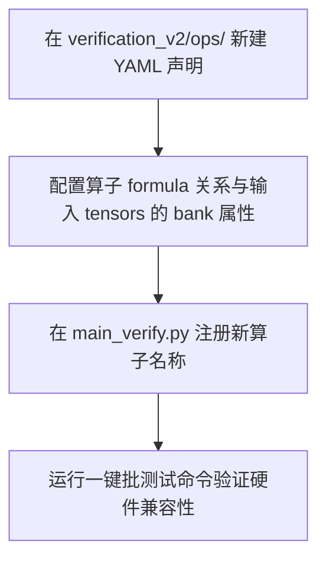

# AIACC 物理流水线验证框架 (V2.0) 使用指南

本指南旨在说明如何使用工业化、去硬编码升级后的 **AIACC 验证框架 (V2.0)**。该框架采用了坚固的 **SSoT (Single Source of Truth, 单一事实源)** 架构，确保编译器行为与硬件物理规格绝对对齐。

---

## 1. 核心架构与 SSoT 来源

验证框架的全部物理决策、存储拓扑与硬件打包均**动态感知**自 `hw_config/` 目录下的硬件描述配置文件。

| 物理属性 | 硬件配置文件路径 | 运行时动态逻辑与自适应解析 |
| :--- | :--- | :--- |
| **SIMD 通道数** | `hw_params.yaml` | 根据 `PARAM_SMC_VECTOR_WIDTH` / `Precision` 动态计算。 |
| **存储 Bank 深度** | `hw_params.yaml` | `PARAM_UR_BANK_DEPTH` (动态自适应 DFG 地址生成、数据注入偏移与模转换)。 |
| **存储 Bank 数量** | `hw_params.yaml` | `PARAM_UR_BANK_NUM` (控制 `MockProgram` 存储几何结构，自动扩展至 $N$ 个 Bank 零硬编码)。 |
| **算子流水线延迟** | `pipeline_delays.yaml` | 动态获取各执行单元的物理延迟（SMT 求解器自动消化并生成最优排程）。 |
| **指令比特位宽** | `specs/units/*.yaml` | `code_bits` 决定物理 Hex 打包时的指令长度。 |
| **指令字段偏移** | `specs/units/*.yaml` | `code_fields` 定义 `VALID`, `SRC_PREC`, `SUB`, `SEL` 等字段的物理比特位置。 |
| **RtoVR 输入选择** | `rtovr_config.yaml` | `consumers_dr` 定义 Crossbar 物理选择端口 `SEL` 的控制值。 |
| **RtoVR 物理插槽** | `rtovr_config.yaml` | `producers_dvr` 定义物理单元对应的 Crossbar 输出槽位 ID。 |

---

## 2. 快速开始

### 2.1 运行标准批处理验证
使用 `main_verify.py` 可以一键完成从算子表达式解析、SMT 自动排程、LIR 汇编编译、指令物理打包、RTL 级物理仿真、到时序与数值真值双重审计的全过程：

```bash
# 验证单个算子
python3 verification_v2/main_verify.py --op horner

# 验证所有支持的算子（一键跑通 12 大核心算子批测试回归）
python3 verification_v2/main_verify.py --op all
```

### 2.2 运行冒烟测试（支持动态阶数）
验证高阶、稀疏多项式算子的自适应解耦能力：

```bash
python3 verification_v2/scratch/final_smoke_test.py
```

---

## 3. 开发新算子

要增加一个新的验证算子，请遵循以下模块化步骤：



### 3.1 YAML 驱动快速生产 (推荐)
对于 90% 以上的算子，您可以直接通过 YAML 配置文件进行快速扩展：
1. **新建配置文件**：在 `verification_v2/ops/` 中新建文件（例如 `clip.yaml`）。
2. **定义元数据**：
   ```yaml
   name: "clip"
   formula: "Max(min_val, Min(max_val, x))"
   tensors:
     x: { bank: 0, role: "input" }
     min_val: { bank: 1, role: "param" }
     max_val: { bank: 1, role: "param", offset: 1 }
     y: { bank: 2, role: "output" }
   test_data:
     x: { range: [-5.0, 5.0] }
     min_val: [-2.0]
     max_val: [2.0]
   ```

---

## 4. ⚙️ 硬件参数变更自适应指南 (Hardware Modification Compatibility)

为了保证后续硬件参数发生变更时验证框架的**无缝可用性**与**前向兼容性**，我们对整个系统进行了彻底的去硬编码重构。

### 4.1 🔄 100% 自动适应（无需修改任何 Python 代码）

当硬件团队修改以下 YAML 参数时，验证框架会在下次启动时**自动感知并无缝运行**：

> [!TIP]
> **SIMD 矢量宽度变更** (`PARAM_SMC_VECTOR_WIDTH`)
> *   *变更场景*：如物理矢量宽度从 128 bit 变更为 256 bit。
> *   *系统行为*：`LIRPacker` 打包器与求值器会自动利用 `self.element_bits` 自适应计算 `vector_lanes`，自动调整 `.hex` 数据打包列宽（如 `v_lanes*8`），并自适应调整仿真迭代次数 `num_loop_iters`，无任何数值偏差。

> [!TIP]
> **存储 Bank 几何结构变更** (`PARAM_UR_BANK_DEPTH` 与 `PARAM_UR_BANK_NUM`)
> *   *变更场景*：Bank 数量由 8 变更为 16；Bank 深度由 256 变更为 512。
> *   *系统行为*：`MockProgram` 内存分配器会自动分配 $16 \times 512$ 的模拟内存。逻辑地址至物理地址的解析函数将自动根据新边界进行模运算，防止数据覆盖与越界。

> [!TIP]
> **执行单元计算延迟变更** (`pipeline_delays.yaml`)
> *   *变更场景*：浮点乘法器延迟 `FPMUL` 从 4 拍调整为 5 拍。
> *   *系统行为*：编译器前端的 SMT 约束器会自动将依赖边权重设为 5，并自动求解出符合硬件最高吞吐的时序规划，数值校验器（`Auditor`）也会自动将数学求值序列在时间轴上右移。

---

### 4.2 ⚠️ 需要手动对准或扩展的特殊场景 (Exceptions)

当涉及以下深层次微架构或指令集重构时，硬件团队需要协同修改编译器相关文件：

> [!WARNING]
> **1. 增加了全新的执行单元类别（如新增异构算力单元 `FP32ADDTREE8TO1`）**
> *   **需要调整的代码**：
>     - **`hw_spec.py`**：在 `HardwareParams` 与 `RouteType` (RT) 枚举类中追加注册该算力单元。
>     - **`standard_kernels.py`**：在 `KernelRegistry` 中为该硬件单元对应的数学表达式添加下沉映射规则。

> [!WARNING]
> **2. 改变了内存物理流水线寄存器的拍数约束**
> *   *背景*：当前框架基于芯片微架构规范规定了 **`Physical_Cycle = 2 + SMT_t`**（由于 SRAM 读出固定存在 2 拍的物理流水延迟）。
> *   *需要调整的代码*：
>     - 如果未来硬件微架构砍掉了一级寄存器，使得 SRAM 读出变为 1 拍，需要协同修改 [auditor.py](file:///home/yq/1_code/aiacc_compiler/verification_v2/infra/auditor.py) 的时序审计期待值计算，以及 [visualizer.py](file:///home/yq/1_code/aiacc_compiler/verification_v2/infra/visualizer.py) 的 `print_aligned_timeline` 时序偏差常量。

> [!WARNING]
> **3. 自定义了全新的数据精度（如 `FP8` 或混合比特精度）**
> *   **需要调整的代码**：
>     - **`emitter.py`**：在 `_handle_program_data` 中为全新的数据类型追加 struct 打包和位移配置（例如对 FP8 选用合适的 `<b` / `<B` 拼装模式）。

---

## 5. 调试工具箱 (Diagnostics)

当仿真发生数值 FAILED 或时序未对准时，请按以下顺序高效诊断：

1.  **极简静默日志**：默认运行不刷屏，只在**失败时**瞬间打印出故障单元的 physical header 以及 expected 数值差异诊断。
2.  **物理时序图**：使用 `--model` 开启调试，在控制台会实时回显 **`(REVIEW-VIEW)` 垂直时序占空图**，可直接看到理论预期与仿真实际执行的每一拍波形对比。
3.  **时序依赖报告**：检查生成的 `compiler_schedule.json` 确定 SMT 求解结果，若 UNSAT 说明当前约束过紧，可尝试在硬件延迟 YAML 中放宽约束。

---
*Last Updated: 2026-05-06*
*AIACC Compiler Industrialization Team*
